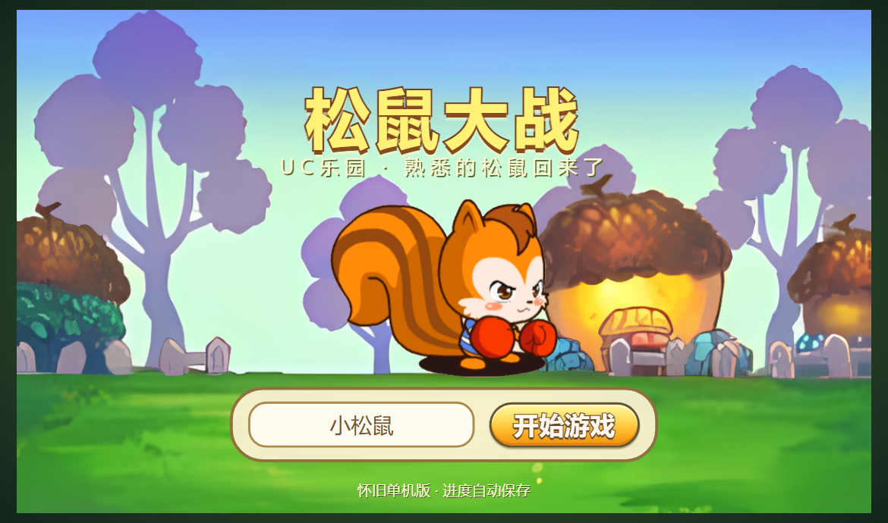
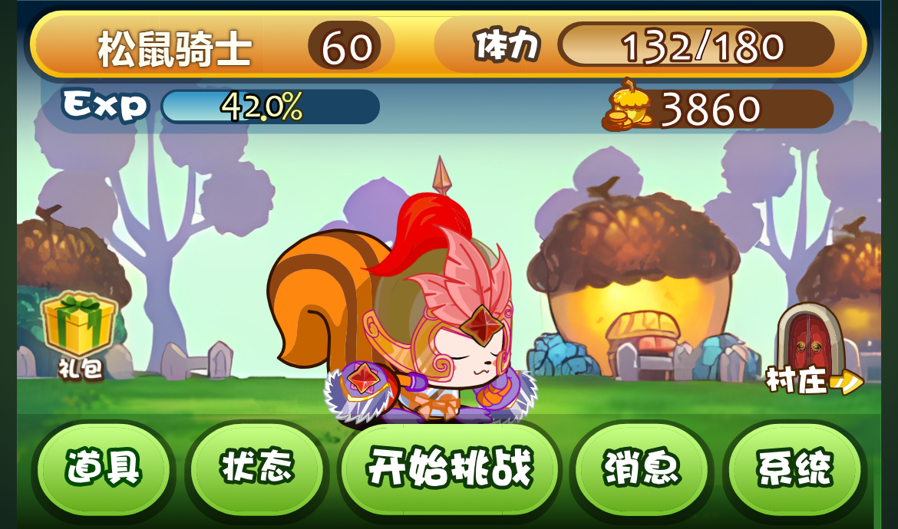
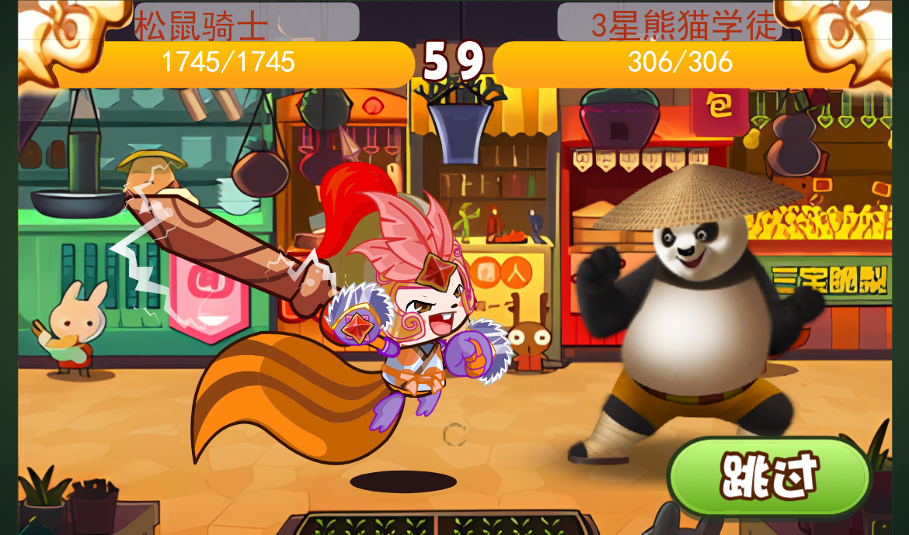
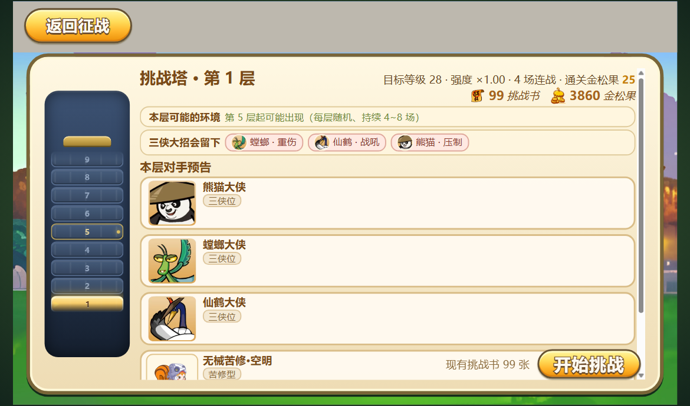
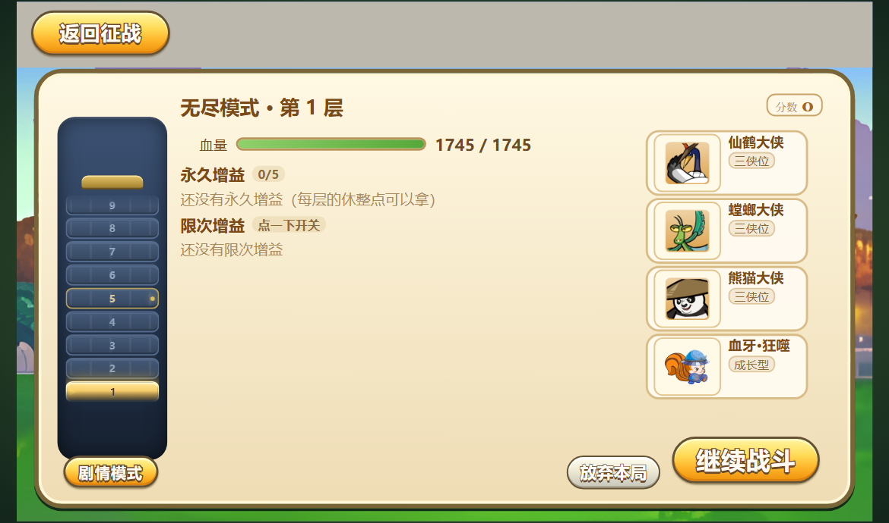

# 松鼠大战 · 怀旧单机复刻版

12年 UC 乐园中**松鼠大战**游戏玩法重做为**纯静态网页**的单机复刻：三侠闯关、背包装备、
装备融合、幻兽牧场、竞技场天梯、师徒好友、挑战塔与无尽塔。默认**经典界面**（向原版 ssfight
看齐），可在「系统 → 界面模式」切到现代界面 —— 两套界面**各有一份独立存档**。
没有构建步骤，双击启动器就能玩；存档写本地文件，同时支持 Mac ↔ Windows 双机同步。

## 游戏画面

以下都是游戏内实拍（默认的经典界面）；现代界面可在「系统 → 界面模式」里切换。

| 标题画面 | 主界面（经典界面） |
|---|---|
|  |  |

| 关卡：三侠轮战 | 战斗 |
|---|---|
|  |  |

| 挑战塔 | 无尽挑战塔 |
|---|---|
|  |  |

## 安装与启动

> 三条路：
**① 在线试玩**（不安装）
**② Windows / macOS 便携包或安装包**
**③ 安卓 APK**。
> 存档全部留在本地，不上传任何服务器。

### ① 在线试玩（不安装）

浏览器打开 GitHub Pages 地址即可（仓库 Settings → Pages 选 “GitHub Actions”，推 main 自动部署）。
存档落在浏览器 localStorage，换浏览器或清缓存会丢，适合先试玩。

### ② Windows

| 方式 | 安装 / 运行步骤 |
|---|---|
| **便携包（推荐）** | 到 GitHub Releases 下载 `squirrel-web-win.zip` → 解压到任意目录（别放只读目录）→ 双击 `scripts\启动游戏.cmd`。根目录有 `squirrel_fight.exe` 时会直接开原生窗口 |
| **安装包** | 下载 `*.exe`（NSIS）或 `*.msi` 双击安装 → 从开始菜单 / 桌面图标启动。需要系统自带 **WebView2**（Win11 自带，Win10 正常更新的机器一般也有） |
| 直接用仓库里的 exe | 双击根目录 `squirrel_fight.exe`（免安装，但 `js/` `images/` 等素材要和它同目录） |

启动脚本（`scripts\启动游戏.cmd` + `scripts\start-game.ps1`，用于「还没编译 exe / 没有 WebView2 / 想强制走浏览器 / 只读模式」）：

```
scripts\启动游戏.cmd                 # 找不到 exe 时退回「本地服务器 + 浏览器应用窗口」
scripts\启动游戏.cmd --browser       # 强制走浏览器路线
scripts\启动游戏.cmd 8081 --no-save  # 换端口 + 只读（不写存档）
scripts\启动游戏.cmd --stop          # 停掉后台的本地服务器
```

启动顺序：**先找 `squirrel_fight.exe`**（根目录 → `scripts\` → `src-tauri\dist\` → `src-tauri\target\release\`），
找到就开原生窗口；没有或连开三次都没稳住，才退回「本地服务器 + 浏览器应用窗口」。

### ③ macOS

| 方式 | 安装 / 运行步骤 |
|---|---|
| **便携包（推荐）** | 下载 `squirrel-web-mac.zip` → 解压 → 双击 `scripts/启动游戏.command`（停止：`bash scripts/启动游戏.command --stop`） |
| **安装包** | 下载 `*.dmg` → 拖进「应用程序」→ **首次打开请右键（或按住 Control 点）→ 打开**：本项目未做代码签名 / 公证，直接双击会被 Gatekeeper 拦下 |
| 打不开时 | 若提示「已损坏」或「无法验证开发者」：`xattr -dr com.apple.quarantine <游戏目录或 .app>`，然后再右键 → 打开 |

关掉游戏窗口就收尾：启动器打开的是**游戏专用**的 Chrome/Edge 应用窗口，关窗后后台小脚本
（`scripts/game-exit-watch.sh`）会把这个浏览器实例退掉；如果 Terminal 没有别的窗口了，Terminal
也会一起退出 —— Dock 里不会一直留着 bash / Google 的图标。还有别的 Terminal / Chrome 窗口时
不会动它们。日志在 `save/game-exit.log`。

### ④ 安卓（APK）

1. **拿 APK（顺带 Windows exe + 安装包）**：**双击 `scripts\打包.cmd`** 就行 —— 它会
   版本号 patch +1（例如 1.0.0 → 1.0.1）、删掉上一版的旧包、编出
   `src-tauri\dist\squirrel_fight_<版本>_arm64-v8a.apk`（真机）与 `squirrel_fight_<版本>_x64-setup.exe`，
   最后自动清掉 `target\` / Gradle `build\` 那 5~10 GB 缓存。只想回收磁盘就双击 `scripts\清缓存.cmd`。
   需要更细的控制时（`pwsh` 不在就用 `powershell`）：
   `打包.cmd -Version 1.1.0`（指定版本）/ `-SkipApk`（只出 Windows）/ `-KeepCache`（保留缓存，下次编得快）/
   `-DryRun`（只打印计划）；全部开关见 `tools\build-release.ps1` 头部注释。也可以单独打安卓包：
   `powershell -File tools\build-apk.ps1 -Abi x86_64 -Release`（模拟器）。
   产物落在 `src-tauri\dist\`，也可以直接用维护者分享的 APK。
2. **装**：把 APK 传到手机（数据线 / 微信文件 / 网盘）→ 在文件管理器里点开 → 按提示到系统设置里
   允许该来源「安装未知应用」→ 继续安装。
3. 安装时若提示「来源不明 / 未经认证」是正常的：现在用的是 **debug 签名**（自用没问题；
   要长期给别人的手机装，需要自己配 release 签名后重打）。
4. 手机存档在应用私有目录 `/data/user/0/com.ssdz.classic/save/progress.json`，与电脑同一份格式 ——
   用游戏里「系统 → 导入/导出存档」互传。

⚠️ Windows 的 `squirrel_fight.exe`（PE 格式 + Windows API）**不能**装到安卓上，安卓必须用 APK；
反过来 APK 也不能在 Windows 上跑。构建命令与踩坑见 [docs/更新记录.md](docs/更新记录.md) 的「文档收敛」一条，以及 `tools/build-apk.ps1` 头部注释。

### ⑤ 从源码运行（可选）

```bash
node scripts/serve.js     # 起本地静态服务器（带存档接口）
# 浏览器打开 http://127.0.0.1:8080/
```

游戏本体是纯静态的、没有构建步骤；只有桌面壳 / 安卓壳需要编译（见下面「开发」）。

### 存档位置

| 场景 | 存档文件 |
|---|---|
| 便携包 / 源码运行 | 游戏目录 `save/progress.json` |
| Windows 安装版 | `%APPDATA%\com.ssdz.classic\save\progress.json` |
| macOS 安装版 | `~/Library/Application Support/com.ssdz.classic/save/progress.json` |
| 安卓 | `/data/user/0/com.ssdz.classic/save/progress.json` |
| 在线试玩 | 浏览器 localStorage（换浏览器 / 清缓存会丢） |

磁盘优先、localStorage 只是兜底；启动时会自动体检存档，损坏就从 `save/backup/` 恢复快照，
两处同时有存档时按 `savedAt` 取较新的那份。**经典 / 现代两套界面共用这一个存档文件**，
里面按界面分成两个独立槽位，互不影响；系统里还有导出 / 导入存档，换机器同步后设置照旧生效。

## 玩法

- **关卡**：10 级开启，36 关推进（3 扇普通大关 + 3 扇超级大关）。前 18 关分三个大关
  （螳螂 → 仙鹤 → 熊猫，各 6 关），每轮 1 张挑战书、连打 3 名对手；19–36 超级关每关 1 名强敌。失败最多复活 2 次，每次再耗 1 张挑战书。
- **战斗**：经典 1170×690 画布，选对手点「挑战他」后自动进行（每场 10 体力）；普攻 / 技能 / 道具，
  暴击、闪避、吸血、反伤、护盾、中毒、复活等机制；最近 50 场战斗可在「消息」里回放。
- **成长**：升级给属性点与礼包，并随机领悟武器 / 技能（状态页查看与升级）；经验丸与属性丸等道具。
- **背包与装备**：部位 × 品质（普通 → 优秀 → 杰出 → 卓越 → 传说），强化、镶嵌与套装收益
  （同名 2 件 / 4 件两档，按所穿最低品质算）；10 个装备碎片可合成装备。
- **装备融合**：3 件同部位、同品质装备合成 1 件更高一级；凑同名可保名（三件同名 97%、两件同名 50%），
  小概率变异「狂战」；宝石（45 级后掉落）可镶入橙装，每件限 1 颗。
- **竞技场与天梯**：10 级开经验场，15 级开碎片场 / 幻兽场（报名一次打完两场，按名次发奖励）；
  天梯赛 30 级开启 —— 胜场攒金杯与积分，可在金杯商店换稀有奖励。
- **师徒与好友**：拜师收徒领贡品（收徒上限随等级提升，最多 3 个）；好友切磋与随机挑战。
- **幻兽牧场**：村庄里孵化、编队、喂养、进化；孵化每只 200 孵化点；体力不足时可用召唤证
  （道具商店 10 金松果）报名幻兽竞技场。
- **每日礼包与开箱**：每日礼包连续登录天数越多金松果越多（第 7 天多 1 张挑战书）；
  金宝箱 / 魔法袋可开出召唤证、宝石、蓝色碎片、孵化点等，超级大关通关也有几率掉金宝箱。
- **挑战塔**：**相对原版新增模式**；通关前 18 关解锁，不封顶；每层 1 张挑战书，层内连战只继承剩余血量，沿途有增益三选一。
- **无尽挑战塔**：**相对原版新增模式**；免门票的 Roguelike 无尽模式（带剧情线）；限次 / 永久 / 即时三类增益随层叠加，冲更高分数与抽奖卷。
- **双界面**：默认经典界面（原版 ssfight 风格），「系统 → 界面模式」可切现代界面；两套界面各自独立存档。
- **双机同步**：Mac ↔ Windows 通过 ZeroTier 互推存档与游戏文件（`scripts/一键同步`）。
- **完全免费**：没有内购、没有广告；「系统」页最上方有一个**自愿支持作者**的入口（爱发电），升到 30 级时也会提示一次 —— 打赏不换取任何游戏内好处，不影响内容与平衡。

## 更新记录

改动按批次记在 [docs/更新记录.md](docs/更新记录.md)（唯一变更日志，最新在上，含原版对比与真化数值结论）；
公开发布沿 `git log` 与 Releases 回溯。

## 开发

纯静态：游戏本体没有构建步骤（`css`/`js`/`images`/`audio` 直接就是运行时产物），
只有桌面壳与安卓壳需要编译。

### 目录结构

| 目录 / 文件 | 作用 | 主要内容 |
|---|---|---|
| `scripts/` | **运行入口与本地服务器**（双击启动、存档接口、一键出包都在这） | `index.html` 首页（服务器把它映射成 `/`）、`serve.js` / `serve.py` 静态服务器（带 `/__save` 存档接口与 `/__update` 一键更新接口）、`update-game.js`（一键拉取远端更新的执行体：git pull / GitHub 便携包 / 安装包，零依赖；本机版本读同目录的 `version.json`）、`version.json`（版本标识）、`打包.cmd` / `清缓存.cmd`（一键出包 / 一键回收磁盘，薄壳转给 `tools\build-release.ps1`）、`启动游戏.command`（macOS 双击入口）、`启动游戏.cmd` + `start-game.ps1`（Windows 兜底入口）、`停止游戏.command`、`一键同步.command` / `一键同步.cmd`、`重启同步服务.cmd`、`game-exit-watch.sh`（macOS 关窗收尾）、`sync/` 双机同步本体、`.gitattributes`（本目录的换行符规则：bash 脚本 LF、`.cmd` CRLF） |
| `js/` | **全部游戏代码**，纯静态加载 | 启动与首页 `main.js`、存档与属性 `state.js`（双界面各自独立槽位）、数值表 `gamedata.js` / `gamedict.js`、现代界面 `ui.js` + `battle*.js`、经典界面 `classic-*.js`、复刻战斗 `ssfight/`、挑战塔与无尽塔 `tower*.js` |
| `css/` | 样式，按模块分文件 | `style.css`（基础）、`classic*.css`（复古界面）、`tower.css`（塔）、`battle-drops.css`、`debug.css` |
| `images/` | 图片素材（**按用途分家**） | `ui/`（现代界面：`icons/<类型>/`、`sprites/`、`numbers/`、`screens/`、`buttons/`、`cards/`、`characters/`、`home/`、`skins/`）、`battle/`（现代战斗：`bg/` 背景、`fx/` 特效、`outfit/` 穿在身上的六部位外观）、`classic/` 与 `ssfight/`（经典界面与复刻战斗的原版素材：页面元件、双方形象、UI 切图）、`atlas/`（原版整片图集，按 id 兜底加载） |
| `audio/` | 音效与 BGM | 战斗音效、主界面 BGM |
| `src-tauri/` | **桌面壳与安卓壳**（Rust + Tauri 2，同一个 crate 出 exe 和 apk） | `src/lib.rs`（全部逻辑，按 `cfg(mobile)` 分支）、`src/main.rs`（桌面入口，仅 8 行）、`Cargo.toml`、`tauri.conf.json`、`tauri.android.conf.json`（安卓构建时自动合并）、`icons/`、`app-icon.png`、`gen/android/`（`tauri android init` 生成的安卓工程，**不进仓库**）、`web/` 与 `dist/`（构建产物） |
| `tools/` | **开发与验证工具**（不参与运行） | 16 个 `test-*.cjs` 主题套件（一条用例对应一条规则；新用例放进主题相符的套件，CI 会枚举整个目录全跑）+ `test-battle.js`（动画/图集）、`check-asset-paths.cjs`（资源路径体检）、**`verify.cjs`**（三个「跑一次几分钟、按需手跑」的验证合在一个入口：`story` 剧情全流程对账机器人 / `layer100` 整百层定向回归 / `stacking` 同名叠加审计，见 [剧情触发条件](docs/剧情触发条件.md)）、`gen-vendor-data.cjs`（从 `references/orig/` 重新生成 `js/gamedict.js`，非运行时）、`ssfight-index.cjs`（经典界面只读查询：加载链 / 元件 / 文本 / 素材索引，配套 [经典模式-优化与取证Skill](docs/经典模式-优化与取证Skill.md)）、`gen-ssfight-ui.cjs` / `gen-ssfight-textfields.cjs`（从原版导出提取经典素材库与文本字段，构建期用）、`check-encodings.cjs`（编码体检：`.ps1` 的 BOM / UTF-8）、`build-release.ps1`（**一键出包**：版本号 +1 → 清旧包 → exe/安装包/APK → 清 5~10 GB 缓存；`scripts\打包.cmd` / `scripts\清缓存.cmd` 是它的双击入口）、`build-tauri-app.cjs`（桌面 exe / 安装包 / `--web` 前端快照）、`build-apk.ps1`（安卓 APK）、`stage-balance.cjs`（关卡数值，被回归调用）、`build-guide.md`（发布与桌面壳指南） |
| `docs/` | 说明文档（**新增需用户同意**，见 `docs/AGENTS.md`） | [更新记录](docs/更新记录.md)（唯一变更日志，最新在上；**原版对比与真化数值的结论也在里面**）、[剧情触发条件](docs/剧情触发条件.md)（无尽塔每条剧情的应当触发条件 + 实测对照，**用户点名要的**）、[经典模式-优化与取证Skill](docs/经典模式-优化与取证Skill.md)（经典界面按问题查阅的取证参考）、[双语与本地化方案](docs/双语与本地化方案.md)（未落地方案） |
| `save/` | **运行时的存档目录**（不进仓库） | `progress.json` 正式存档、`backup/` 快照、`server.out.log` / `server.err.log` |
| `references/` | 原版 APK 与参考素材（**纯参考**：本地保留、不进仓库） | 只作对照/取证；游戏与测试都不读它。原版 H5 源码**只留这份**（`references/orig/`）—— `js/orig/` 那份副本 2026-10 已整目录删除，`tools/gen-vendor-data.cjs` 也只认这里 |
| `out/` | **本地产物 / 临时探针工作区**（本地，不进仓库：`.gitignore` 里整目录忽略） | 只放**跑出来的**东西与一次性脚本：截图、渲染对比图、构建日志、临时探针。**用完即删**——长期要反复跑的回归工具放 `tools/`（见上面的 `verify.cjs`），不要在这里养脚本。整个目录删掉不影响游戏、也不影响任何回归 |
| `.github/` | CI 与发布 | `ci.yml`（回归）、`pages.yml`（在线试玩版）、`release.yml`（双平台便携 zip）、`tauri.yml`（桌面/移动安装包） |

根目录只有这五样：`squirrel_fight.exe`（Windows 免安装入口）、`README.md`、`LICENSE`（许可协议）、
`.gitignore`（哪些本地产物不进仓库）、`AGENTS.md`（给 AI 协作者的项目约定）。
macOS/Linux 的本地启动器 `启动游戏.command` 也在根目录，但它是**本机私货**：不进仓库、不参与双机同步
（`.gitignore` 里显式忽略，且只忽略根目录这一个文件）——仓库里给用户双击的那份在 `scripts/启动游戏.command`。
**别的都收进二级目录**：`scripts/version.json`（版本标识，游戏内「游戏更新」拿它和远端 tag 对比）、
`scripts/打包.cmd` / `scripts/清缓存.cmd`（一键出包 / 一键回收磁盘）—— 根目录不再放 `.cmd`。
换行符规则放在 `scripts/.gitattributes`（`.gitattributes` 与 `.gitignore` 一样按目录生效，
所以只作用于 `scripts/`）——bash 脚本必须 LF，否则 mac 上双击会报
`syntax error near unexpected token '$'do\r''`。


测试（Node 直接跑，无依赖）：

```bash
node tools/test-state.cjs         # 存档与属性
node tools/test-mint-shop.cjs     # 无尽塔商店 / 剧情 / 整百层 / 同名叠加
node tools/test-env-buff.cjs      # 环境词缀与主线剧情埋点
# ……tools/ 下共 16 个 test-*.cjs 套件，全绿为准（CI 会枚举整个目录全跑）

node tools/verify.cjs story 4242 5000        # 剧情全流程对账（跑到上千层，逐条核对触发条件）
node tools/verify.cjs stacking               # 同名叠加审计（叠层 / 上限 / 效果放大）
node tools/verify.cjs layer100 3             # 整百层「王庭 + 第一近卫」定向回归
node tools/check-asset-paths.cjs            # 资源路径与大小写体检
node tools/check-encodings.cjs              # 编码体检（.ps1 的 BOM / UTF-8）
```

调试面板：游戏内 `Ctrl+Shift+D`（不影响正式存档）。

## 许可

本项目是《松鼠大战》（UC 乐园）的**非商业同人复刻**：与原作者 / 原厂商无隶属或授权关系，
作者不做任何商业行为，原作素材（名称、角色、美术、音频、原始数值数据）版权归原厂商所有，
将在权利人要求时立即下架或调整。

作者独立设计并实现的部分（复刻代码、新增玩法设计、数值表、文档与工具）© 2026 Charlespkuer：
**允许**个人非商业使用、修改与免费分享（保留署名与本协议）；
**未经书面授权，禁止**任何商业使用，也禁止把它作为商用素材 / 模板分发。

完整条款见 [LICENSE](LICENSE)；商业授权或权利异议请通过 Issue 联系作者。
「自愿支持作者」（爱发电）只是玩家对作者个人的打赏，**不换取任何游戏内好处**，不构成本项目的商业使用；
具体实现见 `js/main.js` 的 `Main.SUPPORT` / `openExternal`，要点见 [docs/更新记录.md](docs/更新记录.md)。
